# xXT-Deck-Ai-TerminalXx

A tactical multi-function terminal for the LILYGO T-Deck ESP32-S3, consolidating AI chat, weather, space weather, cryptocurrency tracking, wildfire and earthquake monitoring, business-jet anomaly tracking, US power-outage monitoring, offline tarot divination, field logging, scripture and reference reading, live news feeds, and system diagnostics into a single portable device.

[](https://www.patreon.com/c/xXQuantumSmokeXx)

<p align="center">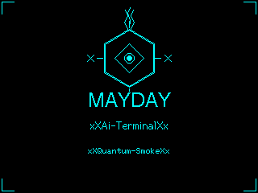</p>

<table><tr>
<td>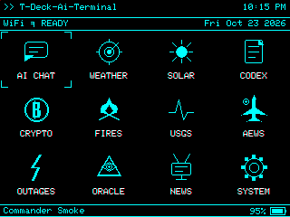</td>
<td>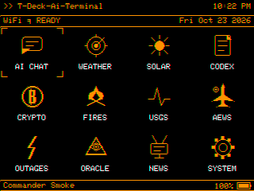</td>
<td>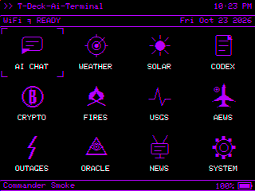</td>
</tr></table>

## Display Gallery

| AI CHAT | WEATHER | SOLAR |
| --- | --- | --- |
| 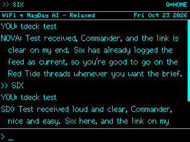 | 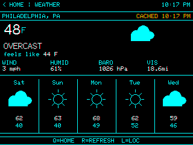 | 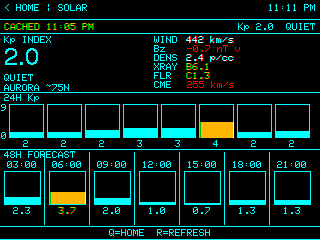 |

| CODEX | CRYPTO | FIRES |
| --- | --- | --- |
| 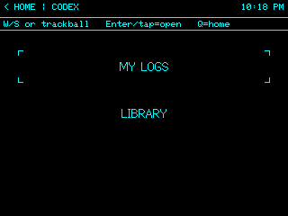 | 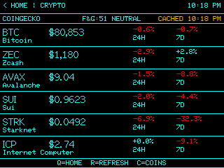 | 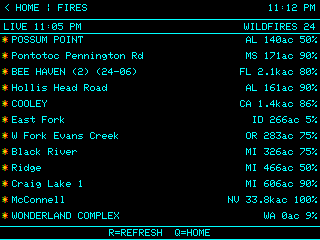 |

| USGS | AEWS | OUTAGES |
| --- | --- | --- |
| 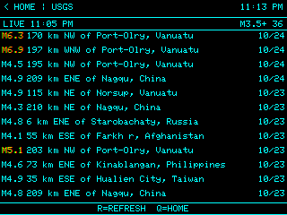 | 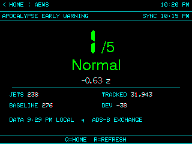 | 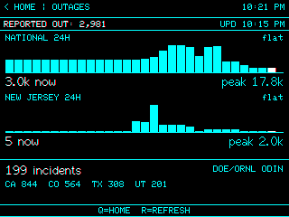 |

| ORACLE | NEWS | SYSTEM |
| --- | --- | --- |
| 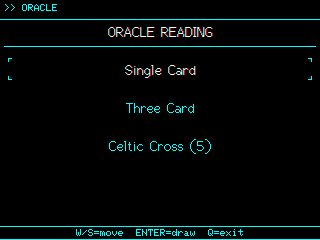 |  | 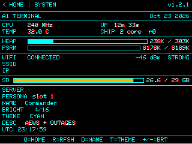 |


## Features

- **AI CHAT** — chat over any single HTTP endpoint (one `POST`, one JSON reply), with persona cards that name one of four backend profiles and optional two-assistant slots for the MayDay portal. No API key is stored on the device.
- **WEATHER** — Open-Meteo forecast with user-configured latitude and longitude, 5-day strip, stats row
- **SOLAR** — NOAA/SWPC space weather via the Quantum-Meteor Worker: Kp history, 48h forecast, Bz, solar wind speed, flares, and CME data in one request
- **CODEX** — Dual-mode hub: **MY LOGS** (field notes on SD card, add/edit/delete with trackball cursor navigation) and **LIBRARY** (KJV scripture reader and other SD-hosted books with chapter index and paragraph-reflowed text)
- **CRYPTO** — Up to six CoinGecko favorites in file order, 24h/7d movement, Fear & Greed, and 7-day sparklines on the two-coin card
- **FIRES** — WFIGS active wildfires via the Quantum-Meteor Worker: name, state, acreage, and containment percent, merged and deduplicated server-side
- **USGS** — 36 most recent M3.5+ earthquakes via the Quantum-Meteor Worker
- **AEWS** — Apocalypse Early Warning System: tracks ~31,000 business jets against their historical baseline and scores the deviation (level 1–5, z-score) via the Worker. Data by [Kyle McDonald](https://ews.kylemcdonald.net/), ADS-B Exchange
- **OUTAGES** — US power outages: national reported total, active incidents, top four states, and two 24-hour sparklines (national + your state). Source DOE/ORNL ODIN via the Worker; the local state comes from Cloudflare's view of the connection, so no location setup
- **ORACLE** — Offline tarot reader: single card, three-card (Past/Present/Future), and five-card Celtic Cross spreads. Full 78-card deck with authentic upright and reversed meanings. Trackball and touch navigation, optional SD save.
- **NEWS** — Ten headlines from the Quantum-Meteor Worker (Reddit r/news, NPR fallback) at reading size, one per 19 px row. NVS-cached, 15-minute TTL.
- **SYSTEM** — Device, WiFi, SD, heap, uptime, backend, persona status, and brightness control
- All data screens cache their last successful fetch for instant load and offline resilience

## Hardware Required

- LILYGO T-Deck, ESP32-S3 version
- microSD card for WiFi, the chat endpoint URL, optional credentials and assistant slugs, personas, the crypto list, cache, field logs, and library books
- WiFi network for the chat endpoint, weather, the Quantum-Meteor feeds, and NTP sync

## Flashing

**Option 1 — M5Launcher (SD card, no USB required):**

1. Grab `T-Deck-Ai-Terminal-v1.2.3.bin` from the [latest release](https://github.com/xXQuantumSmokeXx/xXT-Deck-Ai-TerminalXx/releases/latest) and copy it to your SD card root.
2. Boot into M5Launcher on the T-Deck.
3. Select `T-Deck-Ai-Terminal-v1.2.3.bin` and flash.

**Option 2 — Build and flash from source:**

1. Install PlatformIO and clone this repo.
2. Flash directly over USB:

```sh
pio run --target upload
```

Or build the binary and copy it to SD for M5Launcher:

```sh
pio run
copy .pio\build\T-Deck\firmware.bin F:\T-Deck-Ai-Terminal-v1.2.3.bin
```

## SD Card Setup

The firmware reads plain text files from the SD card root on boot. All setup files are optional after initial configuration — credentials and settings are persisted to NVS — but a file present on the card always wins over the stored value. Deleting a file does **not** clear its stored value; use the matching `set…` command in AI CHAT to clear it.

For chat, the minimum is two files:

```txt
SD root
├── wifi.txt
└── portal.txt
```

Everything else on this page is optional. Ready-made templates for every file live in [`config-examples/`](config-examples), which mirrors the card root.

### `wifi.txt`

Plain two-line format: line 1 is the SSID, line 2 is the password. Do not include labels like `SSID:` or `Password:`.

Example, if the SSID is `frog` and the password is `strawberry`:

```txt
frog
strawberry
```

Read on boot, saved to NVS. Delete after confirmed working.

### `portal.txt` — chat endpoint

```txt
https://your-endpoint.example.com/chat
```

The complete URL of the chat endpoint. One line, no labels; a trailing `/` is stripped.
The deck posts to exactly this URL, which is the default and the only chat file needed.
Delete after confirmed working if desired — the URL is saved to NVS.

**MayDay portal mode (advanced).** If the URL is a base rather than a complete endpoint,
add `assist1.txt` (and optionally `assist2.txt`) with an assistant slug. Requests then go
to `{portal.txt}/{slug}/simple`, which is what the MayDay portal serves. With no assist
file there is no slug, and the URL is used as-is.

### Chat API

**Expected request body:**

```json
{
  "message": "hello",
  "agent_context": { "personality_profile": "Tactical" }
}
```

The deck only ever sends one of these four profile names: `Standard`, `Tactical`, `Relaxed`,
`Maximum Sass`. It never sends a free-text system prompt, and `agent_context` is optional —
a simple endpoint may ignore the whole object and use `message` alone. The device keeps its
own scrollback for display and does not send it.

The chat call is a plain `POST` (with `Content-Type: application/json`) carrying that JSON
and expecting `{"response": "..."}` back, so any backend that speaks that contract works —
the MayDay portal is just the one this firmware was developed against. It also decides what
each `personality_profile` means; the device only names one of the four.

[`examples/endpoint/server.py`](examples/endpoint/server.py) is a working endpoint you run
yourself: it puts this contract in front of Ollama or any OpenAI-compatible API, with the
provider key in your own environment. The deck never carries a key.

When `portal_token.txt` / `commander_code.txt` are present, the request also
carries `X-Portal-Token` and `X-Commander-Code`. A backend that ignores those
headers is fine — leave both files off the card.

**Expected response body:**

```json
{ "response": "assistant reply text" }
```

`response` is required. A 200 with valid JSON but no `response` key draws an empty reply, so
always return the key as a string. Before drawing, the deck strips `*`, `#` and a leading
`- ` list marker (drawn as `»`), and drops triple-backtick fence lines; inline backticks,
links and other Markdown are left as-is. The reply must arrive within 60 seconds.

If the card is not at hand, the endpoint URL can also be changed from AI CHAT with `seturl`.

**HTTPS caveat.** The device accepts any certificate — it does not verify TLS — so the
endpoint's trust comes from the network you run it on. ngrok's tunnel has been unreliable
from this board; prefer a LAN address or a host with a normal TLS stack.

### `assist1.txt` and `assist2.txt` — MayDay portal only

One line each: the assistant slug this device should address for persona slot 1 and slot 2.
With these present, requests go to `{portal.txt}/{slug}/simple`; the MayDay portal serves
`/six/*` and `/nova/*`, so those are the two values.

```txt
SD root
├── assist1.txt   six
└── assist2.txt   nova
```

Both files are optional; a missing one leaves whatever is in NVS untouched. `persona` switches
the card and that slot's assistant together, so the two stay in step. `setassist1` /
`setassist2` remain as a recovery path, and a blank value clears the slot — clear both and
the deck returns to single-endpoint mode. Deleting the files does not clear the stored slugs.

### `portal_token.txt` and `commander_code.txt` — optional, MayDay portal only

The reference backend (the MayDay portal) checks two credentials on every chat
request. **If your backend doesn't, skip both files** — the device only sends
the headers when a value is present.

```txt
SD root
├── portal_token.txt     client token, sent as X-Portal-Token
└── commander_code.txt   access code, sent as X-Commander-Code
```

One line each, no labels. `settoken` / `setcode` are the in-chat recovery path
(masked prompts; blank clears). Both sit in plaintext on the card and in NVS —
treat the card like a key.

### Personas

Each card names one of the four profiles the firmware can send (`Standard`, `Tactical`,
`Relaxed`, `Maximum Sass`). The rest of the card is kept for your own notes and is **not**
sent to the server.

**The folder and file names are fixed — the firmware does not scan for alternatives.** Create
a folder called `personas` in the root of the SD card, then put the cards in it with exactly
these names:

```txt
SD root
└── personas
    ├── p1.txt
    ├── p2.txt
    └── p3.txt
```

The firmware reads those three paths directly — it does **not** create the folder and does
**not** scan for other file names, so `six.txt` or `personas/Six.txt` on a case-sensitive
card will simply be ignored. Slot 1 falls back to a built-in card when `p1.txt` is missing;
slots 2 and 3 load only when their file is present.

**File format:**

```txt
NAME
Title or short role
profile: Tactical
Notes for this card - kept on the SD card, never sent.
```

The `profile:` line may appear anywhere in the body and is removed before the notes are
stored. Allowed values are `Standard`, `Tactical`, `Relaxed` and `Maximum Sass`; anything
else — or no line at all — is treated as `Standard`.

Type `persona` in AI CHAT to cycle slots. In MayDay portal mode each card is paired with the assistant named in `assist1.txt` / `assist2.txt` for that slot, so switching the card switches the brain as well; in single-endpoint mode the card changes the display name and profile only. A slot with no assistant set keeps the current one. The card supplies the display name, title and the `profile:` line sent with each turn — the note text is never sent. Typing an assistant's slug in the chat input switches that alone, without moving the card (portal mode only).

### MY LOGS (CODEX)

The CODEX MY LOGS screen writes field notes to `/logs/field.log`. The firmware creates this file automatically. Keep the SD card inserted for MY LOGS to work. Use the trackball to move the selection cursor, then press **E** to edit or **D** to delete the selected entry.

### LIBRARY (CODEX)

Place plain text books in the SD card root. The firmware auto-indexes them on first open and caches the chapter index in a binary `.idx` file.

**[Project Gutenberg](https://www.gutenberg.org)** is the best source for free plain-text books — tens of thousands of public domain titles including the Bible, classic literature, field manuals, and reference works. Download the **Plain Text UTF-8** version of any title and copy it to your SD card root.

```txt
/kjv.txt          ← KJV Bible (primary tested title)
/warpeace.txt     ← War and Peace, or any Gutenberg plain text
/meditations.txt  ← Marcus Aurelius, etc.
```

The firmware indexes any file matching `/*.txt` in the SD root. Gutenberg format works out of the box — paragraph reflow corrects the 70-character line wrapping so verses and paragraphs read as continuous text. Chapter headings are found from the text's own structure: lines that start with `CHAPTER`, `BOOK`, `PART`, `SURA`, `CANTO`, `SCENE`, `PSALM`, `SECTION` or `APPENDIX`; an inline `Chapter N` (some editions prefix the book name, e.g. `1 Nephi Chapter 1`); a bare number marker; and plain headings sitting between blank lines. Front matter is skipped, so the list starts at the text.

**Tips for best results:**
- Use the **Plain Text UTF-8** download option on Gutenberg — avoid HTML or EPUB
- The KJV Bible (`kjv.txt`) is the primary tested title and is confirmed working
- Very large files (500KB+) take a few seconds to index on first open; subsequent opens are instant from the cached `.idx` file
- Chapter detection (2026-10-23) accepts explicit structure — lines starting with `CHAPTER`, `BOOK`, `PART`, `SURA`, `CANTO`, `PSALM`, an inline `Chapter N` (e.g. `1 Nephi Chapter 1`), or a bare number — as well as plain headings between blank lines. Front matter (`Title:`, `Credits:`, `*** START OF…`) is skipped, and numbers are significant when de-duplicating, so counted headings no longer collapse into one entry
- Indexes rebuild once after a firmware update that changes the format; existing `.idx` files are ignored, not deleted
- A book whose text carries no chapter markers at all (Legge's Tao Te Ching, for example, runs chapter numbers into the prose) will still index coarsely — that is the text, not the parser

### Crypto Favorites

Load up to six CoinGecko coin IDs from `/crypto.txt`, one per line, in the order they should be
displayed:

```txt
bitcoin
zcash
avalanche-2
sui
starknet
internet-computer
```

Use CoinGecko IDs, not ticker symbols. Falls back to `/coins.txt`, then to coins saved on the
device, then to the default BTC/ETH pair. The response is mapped back by ID, so market-cap rank
never reorders the list.

More than two coins switches the screen from the large card to the compact list — 32 px rows
with symbol, name, price, 24 h and 7 d change, and no sparkline. One or two coins get the big
card with the 7-day sparkline. Fear & Greed stays in the status bar either way.

## Controls

### Launcher

| Input | Action |
| --- | --- |
| Trackball up/down/left/right | Move between tiles |
| Trackball click (press ball) | Open selected tile |
| Enter | Open selected tile |
| W/A/S/D or I/J/K/L | Keyboard tile navigation |

### Module Screens

- **Q / Escape / Backspace / Delete**: return home. AI CHAT is the exception: Backspace edits the current line, and Q only returns home when the input is empty (Esc and Ctrl+Q always do)
- **R**: refresh on data screens that support it
- Trackball up/down scrolls lists where the screen has one

### AI CHAT

| Command | Action |
| --- | --- |
| Type + Enter | Send message |
| Trackball up/down | Scroll chat history |
| `persona` | Switch to the next card; in MayDay portal mode it also switches that slot's assistant |
| `clear` | Clear chat history and context |
| `help` | List the commands, including the recovery set |
| `seturl` / `setwifi` | Recovery only — overrides `portal.txt` / `wifi.txt` without the card |
| `setassist1` / `setassist2` | Recovery only — overrides `assist1.txt` / `assist2.txt` (blank clears and returns to single-endpoint mode) |
| `setcode` / `settoken` | Recovery only — overrides `commander_code.txt` / `portal_token.txt` (masked prompts; blank clears) |

Setup is meant to live on the SD card; the `set…` commands exist so a card left at home does not brick the device.

The top bar names what the deck is talking to: `>> SIX` for a portal target, or the active
card's name in single-endpoint mode. In portal mode, typing a slug in the chat input switches
the target and the card with it, so the header follows. In endpoint mode there is nothing to
switch — `persona` only changes the card's name and profile.

### CODEX — MY LOGS

| Input | Action |
| --- | --- |
| Type + Enter | Add a new log entry |
| Trackball up/down | Move selection cursor |
| E | Edit selected entry |
| D | Delete selected entry |
| Del / Backspace | Return to home |

### CODEX — LIBRARY

| Input | Action |
| --- | --- |
| Trackball up/down | Scroll page / navigate chapter list |
| Enter | Open selected chapter |
| J | Chapter index |
| Space | Next page |
| B | Book list |
| Q / Backspace | Back / return to home |

### WEATHER

- **R**: refresh — **L**: set latitude/longitude — **Q**: home
- Coordinates saved to NVS as `wx_lat` / `wx_lon`

### CRYPTO

- **R**: refresh — **C**: open on-device coin ID editor (up to six slots) — **Q**: home

### ORACLE

| Input | Action |
| --- | --- |
| Trackball up/down or W/S | Navigate menu / scroll interpretation |
| Trackball left/right | Navigate spread cards (Past → Present → Future) |
| Enter | Draw cards / confirm selection |
| Touch tab bar | Jump directly to that spread position |
| Touch left/right edge | Previous / next card |
| R | Save reading to SD (`/oracle/readings/`) |
| Q / Backspace / Delete | Back / exit |

### SOLAR

- **R**: force refresh — **Q**: home
- One `/solar` request plus the SWPC 48 h Kp forecast; cached in NVS for an hour

### AEWS

- **R**: force refresh — **Q**: home
- Refetches on open when the last sync is older than 35 minutes (upstream updates every 30)
- Reads `/ews` on the Quantum-Meteor Worker (~130 bytes)

### OUTAGES

- **R**: force refresh — **Q**: home
- Refetches on open when the data is older than 10 minutes, matching the Worker's cache
- Reads `/grid`; the local state is chosen from Cloudflare's geolocation of this device's connection, so there is nothing to configure
- The 24 h history is sampled into the Worker every ~10 minutes and rolls over 24 h — the charts fill in during the first day

### NEWS

- **R**: force refresh — **Q**: home
- Trackball up/down scrolls headlines
- Headlines that don't fit slide sideways on their own, hold at the end, then return; short ones stay put
- Status bar reads `LIVE 10:31 PM` on the left and `10 STORIES 10/23` on the right, and turns amber when the list came from the NVS cache

### SYSTEM

- **R**: refresh diagnostics — **+** / **-**: adjust brightness (saved to NVS) — **T**: open theme color picker — **D**: edit display name — **Q**: home

## Data Sources

| Screen | Source |
| --- | --- |
| AI CHAT | Your endpoint from `portal.txt` — one `POST`, `{"response": ...}` back. Not the Quantum-Meteor Worker |
| WEATHER | Open-Meteo forecast API (direct) |
| SOLAR | Quantum-Meteor `/solar` + SWPC 48 h Kp forecast (direct) |
| CRYPTO | CoinGecko markets + Alternative.me Fear & Greed |
| FIRES | Quantum-Meteor `/fire` (WFIGS, merged + deduped server-side) |
| USGS | Quantum-Meteor `/quakes` (USGS CSV parsed server-side) |
| AEWS | Quantum-Meteor `/ews` (Kyle McDonald's EWS / ADS-B Exchange) |
| OUTAGES | Quantum-Meteor `/grid` (DOE/ORNL ODIN; MassOutage when keyed) |
| NEWS | Quantum-Meteor `/news` (Reddit r/news, NPR fallback) |
| ORACLE | Fully offline — no network required |
| CODEX MY LOGS | Local SD card `/logs/field.log` |
| CODEX LIBRARY | Local SD card plain text books |
| SYSTEM | Local ESP32-S3 state |

Six of the screens share one host: the **Quantum-Meteor** Cloudflare Worker
(`quantum-meteor.qsmoke.workers.dev`). It does the multi-source merging and
parsing server-side, so the device gets 0.1–5 KB of finished JSON instead of
pulling 14–50 KB feeds itself. Weather is deliberately still direct — it is one
small keyless request with no rate limit.

All data screens keep their last successful fetch so they display instantly on re-open and stay useful during brief offline periods (WEATHER, SOLAR and NEWS persist it across reboots; the rest live in RAM). Press **R** on any data screen to force a fresh fetch.

## Security Notes

All SD setup files persist until you delete them. Remove them manually after confirming each works.

- **`wifi.txt`** — contains WiFi credentials
- **`portal.txt`** — contains your chat endpoint URL
- **`portal_token.txt` / `commander_code.txt`** — MayDay portal credentials, sent as headers; omit both for your own endpoint
- **Persona files** — may contain private system prompts
- **HTTPS** — the device does not verify certificates, so a `https://` endpoint is only as trustworthy as the network path to it

Treat the SD card as sensitive. If it is lost or accessed, any remaining setup files are readable in plain text.

The device holds no provider key. If your endpoint calls a hosted model, that key lives on the
machine running the endpoint (an environment variable for `examples/endpoint/server.py`, a
secret for a server of your own), never on the card.

Built by xXQuantum-SmokeXx, with development assistance from Codex and Claude Code.

UI design ported from the "QuantumSix" "VR project", originally developed in collaboration with "Six" & "Nova"... xD
